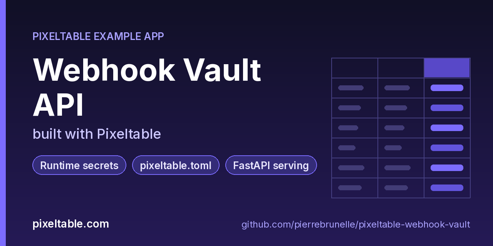

<!-- pixeltable-example-app: 20260926-webhook-vault -->
# Webhook Vault API built with Pixeltable



[](https://codespaces.new/pierrebrunelle/pixeltable-webhook-vault?quickstart=1)
[](https://pixeltable.com)
[](https://pypi.org/project/pixeltable/)
[](https://github.com/pixeltable/pixeltable)
[](LICENSE)

Register outgoing webhooks and let Pixeltable sign them. Every row stores the target URL, event name and payload. A plain SHA-256 **digest** and an **HMAC-SHA256 signature** are computed columns: the signing UDF reads `WEBHOOK_HMAC_SECRET` from the environment at runtime, so the secret never lives in code, in the table schema or in git. Locally it comes from your shell. On Pixeltable Cloud it's a database-scoped secret set with `pxt secret set`.

[Pixeltable](https://pixeltable.com) is open-source, Python-native **multimodal AI data infrastructure**: tables, incremental computed columns, UDFs, indexes and serving in one library, running locally or on Pixeltable Cloud.

> ⭐ **Like this example?** Star [pixeltable/pixeltable](https://github.com/pixeltable/pixeltable) on GitHub. It helps other developers find it.

## What this example shows

- **Secrets** set with `pxt secret set` and read at runtime, never hard-coded
- **`pixeltable.toml` project config**: local and Pixeltable Cloud database sizing in one file
- **Incremental computed columns** powered by plain Python UDFs (`@pxt.udf`)
- **FastAPI serving**: one `FastAPIRouter` turns tables and `@pxt.query` functions into typed REST routes (insert, update, delete, compute and query) with OpenAPI docs
- **Importable UDF module**: UDFs live in `udfs.py`; tables, queries and routes live together in `app.py` (Pixeltable resolves UDFs by module path)
- **`pixeltable.toml`** declares a local database and a **Pixeltable Cloud** database, so the same code deploys with `pxt db update`

## Secrets without hard-coding

```python
# udfs.py
secret = os.environ.get('WEBHOOK_HMAC_SECRET')
if not secret:
    raise RuntimeError('WEBHOOK_HMAC_SECRET is not set')
```

| Where it runs | How the secret gets there |
|---------------|---------------------------|
| Local (`pxt service run`, SDK scripts) | `export WEBHOOK_HMAC_SECRET=...` in the shell that starts the process |
| Pixeltable Cloud | `pxt secret set pxt://<your-org>:<your-db> WEBHOOK_HMAC_SECRET=<value>`, then `pxt db restart pxt://<your-org>:<your-db>` |

If the variable is missing, inserts fail with a clear error instead of storing unsigned rows. The digest column doesn't need the secret, so you can compare payloads without exposing it. Keep secret names free of the reserved `PIXELTABLE_` prefix.

## What's inside

| File | What it is |
|------|------------|
| `.devcontainer/devcontainer.json` | GitHub Codespaces / Dev Container config: Python 3.12, installs `requirements.txt`, forwards port 8000 |
| `.github/social-preview.png` | Social preview image (1280x640) |
| `CITATION.cff` | Citation metadata (authors, license, release date, keywords) |
| `app.py` | The app: tables declared as Python classes, `@pxt.query` functions, and the `FastAPIRouter` routes |
| `client_demo.py` | Sign a payload, register and list webhooks through the API (the service needs WEBHOOK_HMAC_SECRET) |
| `pixeltable.toml` | Project config: the local database plus a Pixeltable Cloud database (sizing, deploy excludes) |
| `seed.py` | Seed a few webhook registrations (needs WEBHOOK_HMAC_SECRET in the environment) |
| `udfs.py` | Pixeltable UDFs (`@pxt.udf`) in their own importable module, imported by `app.py` |
| `requirements.txt` / `pyproject.toml` | Dependencies (`pixeltable[serve]>=0.7.14`) |

**Tables**

| Table | Stored columns | Computed columns |
|-------|---------|------------------|
| `webhooks` | `name`, `url`, `event`, `payload` | `id`, `host`, `digest`, `signature` |

**API routes** (service `vault_api`)

| Method | Path | Kind | Backed by | Notes |
|--------|------|------|-----------|-------|
| `POST` | `/webhooks` | insert | `Webhooks` |  |
| `POST` | `/sign` | compute | `Webhooks` |  |
| `POST` | `/webhooks/delete` | delete | `Webhooks` |  |
| `GET` | `/webhooks/by-event` | query | `deliveries_for` |  |

## Run in your browser (GitHub Codespaces)

[](https://codespaces.new/pierrebrunelle/pixeltable-webhook-vault?quickstart=1)

1. Click **Open in GitHub Codespaces** above (or [this link](https://codespaces.new/pierrebrunelle/pixeltable-webhook-vault?quickstart=1)). The dev container installs Python 3.12 and `pixeltable[serve]>=0.7.14` from `requirements.txt`.
2. In the codespace terminal, create the tables, seed them and start the API:

   ```bash
   pxt schema update app.py vault
   export WEBHOOK_HMAC_SECRET=<any-long-random-string>   # read by udfs.sign_payload at runtime
   python seed.py vault
   pxt service run app.py vault --port 8000   # same shell, so the service sees the secret
   python client_demo.py                     # in another terminal
   ```

3. Codespaces forwards port 8000: open it from the **Ports** tab (or the pop-up) and add `/docs` to the URL for the interactive OpenAPI docs.

This app reads `WEBHOOK_HMAC_SECRET` at runtime. Add it as a [Codespaces secret](https://docs.github.com/codespaces/managing-your-codespaces/managing-your-account-specific-secrets-for-github-codespaces) (the dev container recommends it when you create the codespace) or `export` it in the terminal before starting the service.

## Quickstart

Requires Python 3.11+ and `pixeltable[serve]>=0.7.14`.

```bash
git clone https://github.com/pierrebrunelle/pixeltable-webhook-vault.git
cd pixeltable-webhook-vault
python -m venv .venv && source .venv/bin/activate
pip install -r requirements.txt

# Create the tables in a local catalog directory named `vault`
pxt schema update app.py vault

export WEBHOOK_HMAC_SECRET=<any-long-random-string>   # read by udfs.sign_payload at runtime
python seed.py vault
pxt service run app.py vault --port 8000   # same shell, so the service sees the secret
python client_demo.py                     # in another terminal
```

Try it:

```bash
curl -s -X POST localhost:8000/sign -H 'Content-Type: application/json' -d '{"event": "order.created", "payload": "{}"}'
curl -s 'localhost:8000/webhooks/by-event?event=order.created'
```

## Deploy to Pixeltable Cloud

The same `app.py` runs on [Pixeltable Cloud](https://pixeltable.com). Sign in (or get a free trial database with `pxt new`), point the second database entry in `pixeltable.toml` at your own database, then deploy:

```bash
pxt login                       # or: export PIXELTABLE_API_KEY=<your-api-key>
# edit pixeltable.toml: name = 'pxt://<your-org>:<your-db>'
pxt db update pxt://<your-org>:<your-db>                 # build the image and upload the project
pxt schema update app.py pxt://<your-org>:<your-db>       # create the tables at the database root (no per-app folder)
pxt service update app.py pxt://<your-org>:<your-db>      # start the API there
pxt service list pxt://<your-org>:<your-db>              # list hosted services
```

Hosted routes require an API key: send it in the `X-api-key` header (for example `-H "X-api-key: $PIXELTABLE_API_KEY"`). Keep keys in environment variables or `pxt secret set`, never in code.

## Code walkthrough

**1. Business logic is plain Python, in `udfs.py`.** A `@pxt.udf` function can be used as a column expression. Pixeltable records UDFs by module path (`udfs.digest_payload`), so they live in their own importable module rather than inline in the app: the daemon, serving workers and Pixeltable Cloud import it again by that path.

```python
# udfs.py
@pxt.udf
def digest_payload(payload: str) -> str:
    """SHA-256 of the payload (no secret needed)."""
    return hashlib.sha256(payload.encode()).hexdigest()
```

**2. Tables are Python classes (`app.py`).** Annotated attributes are stored columns; attributes assigned an expression are **computed columns** (`id`, `host`, `digest`, `signature`), evaluated incrementally on every insert or update and recomputed when their inputs change.

```python
# app.py
class Webhooks(TableModel, name='webhooks'):
    id = pxt.Column(value=pxtf.uuid.uuid7(), primary_key=True)
    name: pxt.String
    url: pxt.String
    event: pxt.String
    payload: pxt.String

    host = target_host(url)
    digest = digest_payload(payload)
    signature = sign_payload(event, payload)
```

**3. Queries are functions (`app.py`).** `@pxt.query` wraps a Pixeltable query so it can be called from Python or exposed as a route:

```python
# app.py
@pxt.query
def deliveries_for(event: str):
    """Signed deliveries for one event type."""
    return Webhooks.where(Webhooks.event == event).select(
        Webhooks.id, Webhooks.name, Webhooks.host, Webhooks.signature
    ).order_by(Webhooks.name)
```

**4. One router, a full REST API.** `FastAPIRouter` generates request/response models from the column types, validates input, and publishes OpenAPI docs at `/docs`:

```python
# app.py
vault_api = FastAPIRouter(name='vault_api')
vault_api.add_insert_route(
    Webhooks, path='/webhooks',
    inputs=[Webhooks.name, Webhooks.url, Webhooks.event, Webhooks.payload],
    outputs=[Webhooks.id, Webhooks.host, Webhooks.digest, Webhooks.signature],
)
vault_api.add_compute_route(Webhooks, path='/sign', inputs=[Webhooks.event, Webhooks.payload],
                            outputs=[Webhooks.digest, Webhooks.signature])
vault_api.add_delete_route(Webhooks, path='/webhooks/delete')
vault_api.add_query_route(path='/webhooks/by-event', query=deliveries_for, method='get')
```

## Learn more

- 🌐 Website: https://pixeltable.com
- 📚 Docs: https://docs.pixeltable.com
- 💻 Source: https://github.com/pixeltable/pixeltable (⭐ star it if Pixeltable is useful to you)
- 📦 PyPI: https://pypi.org/project/pixeltable/
- 🧩 More example apps: https://pierrebrunelle.github.io/awesome-pixeltable-apps/

**[More Pixeltable example apps →](https://pierrebrunelle.github.io/awesome-pixeltable-apps/)**

---

<sub>Built as part of a daily series of Pixeltable example apps · Pixeltable 0.7.14 · Python, FastAPI, incremental computed columns · Licensed under Apache-2.0.</sub>
